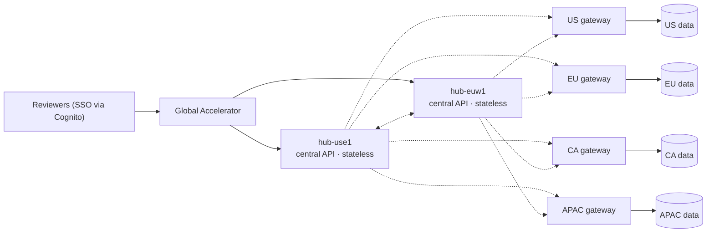

# Multi-Region Observability Platform: Network Layer

This is the network layer for a central platform where internal teams review and rate events from edge devices. The catch is that the event data lives in separate regional AWS stacks (US, EU, CA and APAC) and has to stay there for data-residency reasons. So the question is how to give one central API access to all of it without moving any of it.

If you only read one thing, read the [design doc](docs/architecture.md). The [monitoring doc](docs/monitoring.md) covers metrics and alerting, [deployment.md](docs/deployment.md) covers how the Terraform is organized and rolled out, and the [ADRs](docs/adr) record the main decisions.

## Scope and how to review this

The brief asked for a network design, a basic Terraform module structure, VPC creation and peering code, and a monitoring approach. That core is here:

- **[The design doc](docs/architecture.md)**, with the diagrams and the reasoning behind each decision
- **[The monitoring doc](docs/monitoring.md)**, covering which metrics matter and how alerting works
- **`modules/vpc`**, which builds each VPC with its subnet tiers and route tables
- **`modules/vpc_peering`**, which connects two VPCs across accounts and regions, with routes on both sides
- **`live/prod/connectivity`**, which uses that module to wire up all 9 peering connections

Everything else is supporting work that shows how this would run in production, and it's safe to skim: the probe and alerting modules that implement the monitoring doc, the security groups, the SCPs and change guardrails, the deployer IAM role, the CI pipeline, the tests and the ADRs.

## How it works



Two central "hubs" run the API, one in `us-east-1` and one in `eu-west-1`, behind Global Accelerator. Each hub is peered with every regional VPC, and the two hubs are peered with each other as a fallback path.

A few decisions shape everything else:

- **The regions can't talk to each other.** VPC peering isn't transitive, so even with a bad route, EU traffic can't reach the US VPC through a hub.
- **The hubs never touch a database.** They can only reach a small gateway service in each region. The database subnets don't even have a route back to the hubs, and a network ACL blocks them as well.
- **Nothing is stored centrally.** Video clips go from the regional S3 bucket straight to the reviewer through a short-lived presigned URL.
- **Residency is enforced by AWS, not by convention.** SCPs lock each account to its own regions and block cross-region replication, and every data access is audited inside its own region.
- **Six nines is split in two.** The platform targets 99.9999% by running both hubs at once and retrying on the other hub when one fails. Each region's data gets its own 99.99% target, because EU data can't be more available than the EU infrastructure it's required to live on. [ADR-0003](docs/adr/0003-six-nines-scope.md) explains the reasoning.
- **Monitoring works around a gap in AWS.** VPC peering doesn't publish any CloudWatch metrics, so a probe tests every hub-to-region path every 10 seconds. Alerts are correlated, so on-call gets one page saying "EU is unreachable" instead of eight separate alarms.

## Where to find each part of the brief

| Requirement | Where |
|---|---|
| Architecture diagram: VPC peering, security groups, IAM roles, data-flow paths | [Design doc](docs/architecture.md) sections 3.1 (topology), 4 (request flow), 5.2 (routing and security groups) and 7 (IAM trust) |
| Secure cross-region connectivity that keeps data resident | Design doc sections 5 and 6, [ADR-0001](docs/adr/0001-connectivity-vpc-peering.md), [ADR-0002](docs/adr/0002-regional-gateway-not-direct-db.md) |
| Central reads from every region, writes routed to the owning region | Design doc section 4, ADR-0002 |
| Redundancy, regional failures, 99.9999% | Design doc section 8, [ADR-0003](docs/adr/0003-six-nines-scope.md) |
| Inter-region latency | Design doc section 11 |
| Terraform module structure, and how it's organized and deployed | `modules/`, `live/prod/`, [deployment.md](docs/deployment.md) |
| VPC creation and VPC peering code, with an example of using it | `modules/vpc`, `modules/vpc_peering`, `live/prod/connectivity`, and the example below |
| Why each connectivity option was chosen | Design doc section 9, [`docs/adr/`](docs/adr) |
| Network monitoring: metrics and alerting | [monitoring.md](docs/monitoring.md), `modules/connectivity_probe`, `modules/connectivity_alerting` |
| Security best practices and auditability | Design doc sections 7 and 10, `policies/scp/`, `modules/network_guardrails`, `modules/iam_network_deployer` |
| Assumptions and scope | Design doc sections 2 and 13 |

## Repository layout

```
modules/
  network_plan/            reads network-plan.yaml and works out every subnet CIDR
  vpc/                     3-AZ VPC with tiered subnets, per-tier route tables, NAT, endpoints, data NACL, flow logs
  vpc_peering/             cross-account, cross-region peering plus the routes on both sides
  security_groups/         central_api (hub egress) and regional_gateway (spoke ingress)
  connectivity_probe/      Lambda that times DNS, TCP, TLS and first byte from each hub to each region
  connectivity_alerting/   per-path alarms rolled up into region, hub and path alerts
  network_guardrails/      alerts on network changes made outside Terraform, plus Config rules
  alert_topic/             encrypted SNS topics for pages and tickets
  iam_network_deployer/    the CI deployer role, with a boundary that blocks any data access
live/
  bootstrap/deployer-role/ run once per account
  prod/
    network-plan.yaml      the one place accounts, regions, CIDRs and subnet layouts are defined
    spoke/                 -var spoke=us|eu|ca|apac
    hub/                   -var hub=use1|euw1
    connectivity/          all 9 peering connections
    observability/         -var hub=use1|euw1
policies/scp/              region lock, residency guardrails, protection against network changes
docs/                      design doc, monitoring, deployment, ADRs
```

## Quick start

```bash
make validate                                  # format check, then init and validate every stack
make test                                      # unit tests for the network plan, including the overlap check
make lock                                      # regenerate the provider lock files for macOS and Linux
make plan  STACK=spoke INSTANCE=eu             # needs AWS credentials for the CI role
make apply STACK=connectivity INSTANCE=prod
```

The deployment order and the CI/CD pipeline are described in [deployment.md](docs/deployment.md).

## Example: wiring up one peering connection

This connects the hub in `eu-west-1` to the EU spoke in `eu-central-1`. The routes only cover the hub's app subnets and the spoke's interconnect subnets, never whole VPCs.

```hcl
module "peer_hub_euw1_spoke_eu" {
  source = "../../../modules/vpc_peering"
  providers = {
    aws.requester = aws.hub_euw1   # hub-euw1 account, eu-west-1
    aws.accepter  = aws.spoke_eu   # EU account,      eu-central-1
  }

  name = "hub-euw1--spoke-eu"

  requester = {                                         # hub app tier → EU interconnect tier only
    vpc_id            = local.hub["euw1"].vpc_id
    route_table_ids   = local.hub["euw1"].app_route_table_ids
    destination_cidrs = local.spoke_interconnect_cidrs["eu"]   # 10.30.240-242.0/24
  }

  accepter = {                                          # return path from interconnect tier only
    vpc_id            = local.spoke["eu"].vpc_id
    route_table_ids   = local.spoke["eu"].interconnect_route_table_ids
    destination_cidrs = local.hub_app_cidrs["euw1"]            # 10.11.16.0/20 ×3
  }
}
```

## Main assumptions

The full list is in section 2 of the design doc. The ones that matter most:

- The center can *process* regional data as it passes through, but can't *store* it. Whether staff in one country may view another country's data is a legal question. If the answer is no, the design can pin a jurisdiction to its own hub with a one-line change.
- Reviewers are internal staff. They sign in through a Cognito user pool in each hub, both connected to the corporate identity provider, and their region permissions come from their groups there.
- The regional VPCs can be given non-overlapping IP ranges. Any region that can't uses PrivateLink instead ([ADR-0001](docs/adr/0001-connectivity-vpc-peering.md)).
- Monitoring data contains no personal information, which the brief states. Services log event IDs, never event contents.

## What's built and what's only designed

**Built:** the networking modules and live stacks for 2 hubs, 4 regions and all the peering between them, plus security groups, network ACLs, flow logs, the probe, the correlated alerting, the change guardrails, the deployer IAM role and the SCPs.

**Designed but not built** (described in the design doc): the central API and regional gateway services, Global Accelerator, the ALBs and WAF, the Cognito pools, Private CA and private DNS zones, and the cross-account monitoring setup and dashboards.

## Validation

I validated everything with Terraform 1.10.5 and version 5.100 of the AWS provider using `make validate`, and the committed lock files cover macOS and Linux. None of it has been applied to a real AWS account, and the account IDs in `network-plan.yaml` are placeholders.
