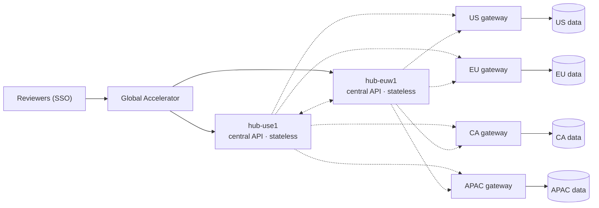

# Multi-Region Observability Platform: Network Layer

Terraform and design documents for a **centralized observability platform** that lets internal teams review and rate edge-device events stored in **data-resident regional AWS stacks** (US, EU, CA, APAC), without moving that data out of its jurisdiction.

> **Start here:** [`docs/architecture.md`](docs/architecture.md) (design, diagrams, security, decisions) · [`docs/monitoring.md`](docs/monitoring.md) (metrics and alerting) · [`docs/deployment.md`](docs/deployment.md) (module organization and rollout) · [`docs/adr/`](docs/adr) (decision records)

## The design at a glance



- **Dual hub-and-spoke over inter-region VPC peering.** Every region is reachable from two independent hubs. Regions can never reach each other, because peering is non-transitive.
- **Hubs reach only a regional gateway** in a dedicated interconnect subnet tier, never a database. The data tier has no route to the hubs, and a NACL backs that up.
- **No event data at rest centrally.** Video goes straight from regional S3 to the reviewer via presigned URL.
- **Residency enforced by the platform:** region-lock SCPs, no cross-region replication or multi-region keys, in-region access audit.
- **Six nines, stated honestly:** active-active hubs with failure-oblivious retries for the platform, and a separate per-region data SLO bounded by residency ([ADR-0003](docs/adr/0003-six-nines-scope.md)).
- **Monitoring built for a network with no native peering metrics:** a hub × region probe matrix with correlated composite alarms that page on impact and stay alive if a whole region is lost.

## Repository layout

```
modules/
  network_plan/            pure data: network-plan.yaml → derived subnet CIDRs
  vpc/                     3-AZ tiered VPC · per-tier route tables · NAT · endpoints · data NACL · flow logs
  vpc_peering/             cross-account, cross-region peering + both sides' routes
  security_groups/         central_api (hub egress) · regional_gateway (spoke ingress)
  connectivity_probe/      Lambda probe: DNS / TCP / TLS / TTFB per hub → region
  connectivity_alerting/   pair alarms → composite alarms (region / hub / path)
  network_guardrails/      out-of-band network change detection + Config rules
  alert_topic/             KMS-encrypted SNS for pages and tickets
  iam_network_deployer/    CI deployer role; permissions boundary denies the data plane
live/
  bootstrap/deployer-role/ once per account
  prod/
    network-plan.yaml      single source of truth: accounts, regions, CIDRs, subnet layouts
    spoke/                 -var spoke=us|eu|ca|apac
    hub/                   -var hub=use1|euw1
    connectivity/          the 9 peering connections
    observability/         -var hub=use1|euw1
policies/scp/              region-lock, residency guardrails, network-change protection
docs/                      architecture, monitoring, deployment, ADRs
```

## Quick start

```bash
make validate                                  # fmt + init(-backend=false) + validate every stack
make lock                                      # (re)generate committed provider lock files for macOS + Linux
make plan  STACK=spoke INSTANCE=eu             # needs AWS credentials for the CI role
make apply STACK=connectivity INSTANCE=prod
```

Deployment order and CI/CD are in [`docs/deployment.md`](docs/deployment.md).

## Example: instantiating the peering module

```hcl
module "peer_hub_euw1_spoke_eu" {
  source = "../../../modules/vpc_peering"
  providers = {
    aws.requester = aws.hub_euw1   # central account, eu-west-1
    aws.accepter  = aws.spoke_eu   # EU account,      eu-central-1
  }

  name = "hub-euw1--spoke-eu"

  requester = {                                         # hub app tier → EU interconnect tier only
    vpc_id            = local.hub["euw1"].vpc_id
    route_table_ids   = local.hub["euw1"].app_route_table_ids
    destination_cidrs = local.spoke_interconnect_cidrs["eu"]   # 10.30.240-242.0/24
  }

  accepter = {                                          # return path from interconnect tier only
    vpc_id            = local.spoke["eu"].vpc_id
    route_table_ids   = local.spoke["eu"].interconnect_route_table_ids
    destination_cidrs = local.hub_app_cidrs["euw1"]            # 10.11.16.0/20 ×3
  }
}
```

## Assumptions (full list in the design doc §2)

- The center may *process* regional data in transit but must not *store* it. The legal basis for cross-border access is Legal's call, and the design can pin a jurisdiction to its own hub with a one-line change.
- Reviewers are internal staff on the corporate IdP. Region entitlements come from IdP groups.
- Regional CIDRs can be made non-overlapping. Any spoke that can't uses PrivateLink instead ([ADR-0001](docs/adr/0001-connectivity-vpc-peering.md)).
- Monitoring data has no PII (given), and services log IDs, never payloads.

## Scope

**Implemented:** networking modules and live stacks for 2 hubs, 4 spokes and the full peering mesh; security groups, NACLs, flow logs; probe, correlated alerting and change guardrails; deployer IAM role; SCPs. All stacks pass `terraform validate`.
**Designed, not implemented:** central API and regional gateway services, Global Accelerator/ALB/WAF, Private CA and private hosted zones, OAM wiring and dashboards. These are described in the design doc.

## Validation

Validated with Terraform 1.10.5 and `hashicorp/aws` 5.100 (`make validate`); provider lock files cover macOS and Linux (`make lock`). The code was not applied to live accounts; account IDs in `network-plan.yaml` are placeholders.
