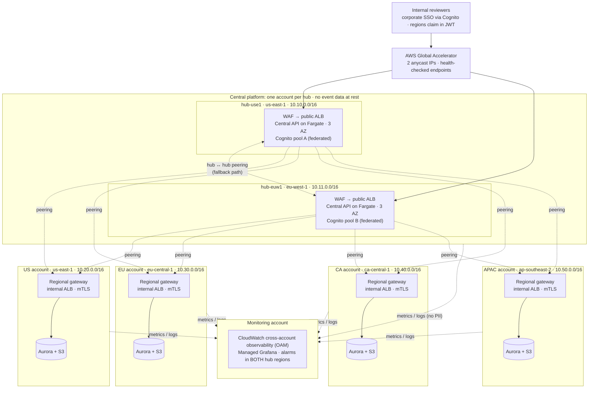
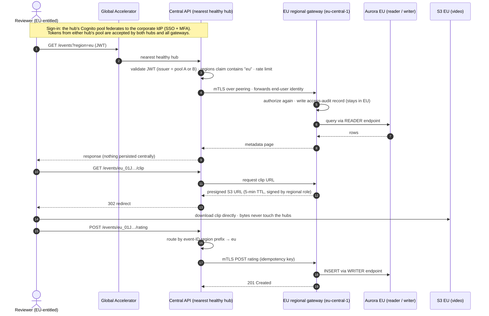
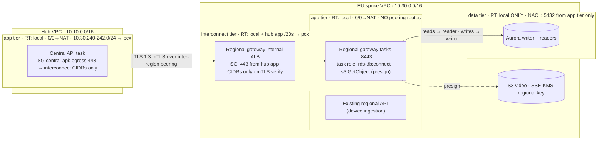
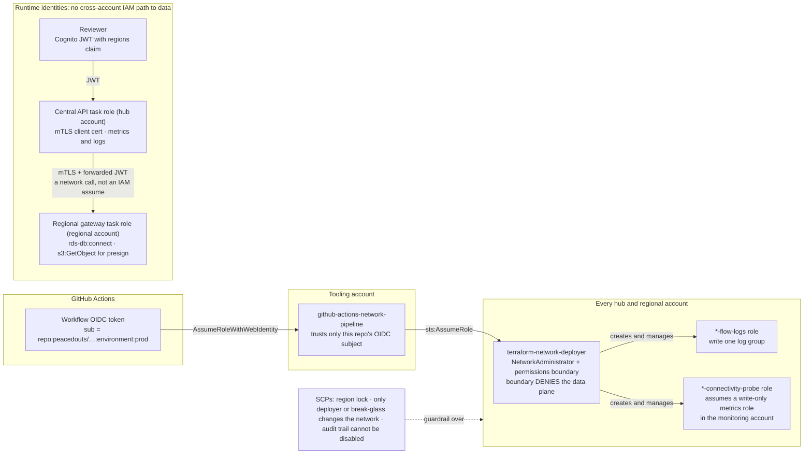

# Infrastructure Design: Centralized Observability Platform across Data-Resident Regions

**Author:** Zachary Adams · **Status:** Proposal for review · **Scope:** network and connectivity layer, with the security, availability and data-residency decisions that depend on it

---

## 1. Summary

Internal teams need one place to review and rate edge-device events. The event data (video and metadata) must stay in the regional AWS stacks (US, EU, CA, APAC), each in its own account and VPC.

**The short version.** Two central **hubs** run the API, one in `us-east-1` and one in `eu-west-1`, both active at once behind AWS Global Accelerator. Each hub is connected to every regional **spoke** by VPC peering, and the two hubs are peered with each other as a fallback.

The peering routes are deliberately narrow. A hub can only reach one small subnet tier in each region, the **interconnect tier**, which holds that region's **regional gateway**: an internal load balancer that requires mutual TLS. The gateway is the only thing that talks to the regional database, and it records every access inside the region.

Nothing central stores event data. Video never passes through the hubs either: the region hands out a short-lived presigned URL and the reviewer downloads the clip straight from the regional bucket. Monitoring data has no personal information, so that part is centralized. A probe checks every hub-to-region path, and alerts are correlated so on-call is paged for real impact, not for every raw signal.

| Decision | Choice | Main reason |
|---|---|---|
| Cross-region connectivity | Inter-region VPC peering, dual hub-and-spoke (8 + 1 connections) | Non-transitive by default (regions can never reach each other), no hourly or processing charges, no bandwidth bottleneck, no appliance in the path. See [ADR-0001](adr/0001-connectivity-vpc-peering.md). |
| What the center can reach | A regional gateway in an interconnect subnet, never the database | Keeps credentials, schema, authorization and audit inside the jurisdiction. Writes always land in the right region, because each region's gateway can only write to its own database. See [ADR-0002](adr/0002-regional-gateway-not-direct-db.md). |
| Availability model | Two stateless hubs serving at once, failures absorbed by retries, one region failing doesn't take down the others | Six nines is only reachable if no single region, path or deploy can cause an error a user sees. See [ADR-0003](adr/0003-six-nines-scope.md). |
| Address plan | One reviewed `network-plan.yaml`; subnet CIDRs derived from it | Peering requires non-overlapping CIDRs, and every route and SG rule must be precise. See [ADR-0004](adr/0004-ip-address-plan.md). |
| Identity | Amazon Cognito user pool per hub, both federated to the corporate IdP; tokens from either pool accepted by both hubs and every regional gateway | Reuses the regional stacks' Cognito/JWT model without making one region's pool a single point of failure. See [ADR-0005](adr/0005-identity-cognito-per-hub.md). |
| Residency enforcement | SCP region-lock + no data at rest centrally + regional KMS + in-region audit | Residency is enforced by the platform, not by convention. |

---

## 2. Requirements and assumptions

**From the brief:** separate VPCs and accounts per region; central read access to every region, with writes routed to the owning region; data residency; significant inter-region latency; 99.9999% target; comprehensive monitoring; everything in IaC; AWS only; auditable; security best practices.

**Assumptions I added (to be confirmed):**

1. **The center may *process* regional data in transit but must not *store* it.** Viewing EU data from a hub outside the EU is still a cross-border access under GDPR. The legal basis (SCCs/DPF, DPA with the client) is a legal decision, not a network one. The design supports both answers. Reviewers can be pinned to the in-jurisdiction hub (EU reviewers → `eu-west-1`), and if Legal requires it, EU-bound calls can be restricted to the EU hub with one SG and route change.
2. **Video is the heavy, sensitive part.** Clips are served from the regional S3 bucket via presigned URL and never proxied centrally.
3. **Reviewers are internal staff** with accounts in the corporate IdP (Okta/Entra-style SSO). They sign in through a **Cognito user pool in each hub**, federated to that IdP, matching how the regional stacks already authenticate with Cognito. IdP group membership maps to a `regions` claim (`["eu","us"]`) in the Cognito token.
4. **The regional stacks exist.** The spoke stack is written greenfield for clarity. In practice it imports the existing VPC and *adds* the interconnect tier, gateway SG and guardrails (see `live/prod/spoke/main.tf`).
5. **CIDRs can be made non-overlapping.** If an existing spoke overlaps and can't be re-addressed, that spoke uses PrivateLink instead of peering (ADR-0001). The interconnect-tier contract stays the same.
6. **Region choice:** US `us-east-1`, EU `eu-central-1`, CA `ca-central-1`, APAC `ap-southeast-2`. Each also has an in-jurisdiction DR region reserved (`us-west-2`, `eu-west-1`, `ca-west-1`, `ap-southeast-4`). APAC residency is country-specific; "APAC" is treated as one jurisdiction (Australia) here, and other APAC countries become new spokes. `hub-use1` and the US spoke share `us-east-1`, so that one peering is intra-region rather than inter-region. That is deliberate: the busiest region gets the lowest latency, and the `vpc_peering` module handles both cases. The design does not rely on it, because security groups use CIDRs everywhere for consistency, even where same-region SG references would be possible.
7. **Monitoring data contains no PII** (given). I add one enforcement: services log event IDs, never payloads, checked by a log-scrubbing test in each service's CI (the services themselves are outside this repo).

**Explicitly out of scope:** the event ingestion path (devices → MQTT → Lambda fleet), the regional data model and the review UI. This design only adds an access path *into* the existing regional stacks and changes nothing in their ingestion.

---

## 3. Architecture overview

### 3.1 Global topology

There are no spoke-to-spoke connections, and peering is not transitive. EU traffic cannot reach the US VPC through a hub even if a route were added by mistake: AWS does not forward traffic between two peering connections.

### 3.2 Account structure (AWS Organizations)

| OU | Accounts | Notes |
|---|---|---|
| Security | log-archive, audit | Org CloudTrail (S3 Object Lock), Config aggregator, GuardDuty/Security Hub delegated admin |
| Infrastructure | hub-use1, hub-euw1 (one account each), monitoring, tooling (CI/OIDC, state) | Hubs hold no event data. Separate hub accounts mean an IAM mistake, a leaked credential or an exhausted service quota can only affect one hub. |
| Regional Workloads | us-prod, eu-prod, ca-prod, apac-prod (+ non-prod twins) | Region-lock SCP per account, residency guardrail SCPs |

Every account boundary is also a blast-radius and audit boundary. An auditor for the EU can be given read access to the EU account alone and see every access to EU data in it.

---

## 4. Request and data flow

**Read/write routing.** Event IDs carry their home region (`eu_<ULID>`). The central API keeps a static map from region to gateway endpoint, generated from `network-plan.yaml`, so a write can only ever go to the owning region. Reads go to the Aurora reader endpoint and writes to the writer endpoint. That split happens inside the regional gateway, where the credentials live.

**Cross-region views** ("show me all unreviewed events"): the hub scatter-gathers to all regions in parallel. Each region gets its own deadline based on its measured RTT, and the response is partial if a region is slow or down (`"regions_unavailable": ["apac"]`). One bad region never fails the whole request.

---

## 5. Network design

### 5.1 Address plan

All addressing comes from [`live/prod/network-plan.yaml`](../live/prod/network-plan.yaml). Subnet CIDRs are a pure function of (VPC CIDR, layout, AZ index), so any stack can compute the other side's CIDRs for routes and SG rules without reading its state.

| VPC | CIDR | public /24 ×3 | app /20 ×3 | data /20 ×3 | interconnect /24 ×3 |
|---|---|---|---|---|---|
| hub-use1 | 10.10.0.0/16 | 10.10.0-2.0 | 10.10.16.0 – 10.10.63.255 | – | – |
| hub-euw1 | 10.11.0.0/16 | 10.11.0-2.0 | 10.11.16.0 – 10.11.63.255 | – | – |
| spoke-us | 10.20.0.0/16 | 10.20.0-2.0 | 10.20.16.0 – 10.20.63.255 | 10.20.64.0 – 10.20.111.255 | 10.20.240-242.0 |
| spoke-eu | 10.30.0.0/16 | 10.30.0-2.0 | 10.30.16.0 – 10.30.63.255 | 10.30.64.0 – 10.30.111.255 | 10.30.240-242.0 |
| spoke-ca | 10.40.0.0/16 | … | … | … | 10.40.240-242.0 |
| spoke-apac | 10.50.0.0/16 | … | … | … | 10.50.240-242.0 |

Ranges are reserved for in-jurisdiction DR VPCs and future jurisdictions. Two guardrails keep ranges from overlapping: every Terraform plan fails if two VPC ranges in the plan overlap (checked in the `network_plan` module, with a test), and the plan is mirrored into AWS VPC IPAM pools so nothing created outside this repo can take an overlapping range.

### 5.2 Inside a spoke: who can route where

**Four independent layers have to fail together before the center can touch the database:**

| Layer | Control | What it stops |
|---|---|---|
| Routing | Only spoke interconnect route tables have a return route to the hubs. App and data route tables have none. | Even with an open SG, a hub packet that reached the data tier would get no reply. No route means no TCP session. |
| Peering scope | Routes are /24 and /20 subnet CIDRs, never whole VPCs. A Terraform precondition rejects anything broader than /20. | "Route the whole VPC for convenience" drift |
| Security groups | Gateway ALB: 443 only from hub app CIDRs. Central API: default-deny egress, 443 only to interconnect CIDRs. | Lateral movement, misuse of the peering |
| NACL | Data tier accepts 5432 only from the app tier. The interconnect tier is explicitly excluded. | A compromised gateway ALB reaching Aurora directly |

Cross-region peering does **not** support referencing security groups in the peer VPC, so cross-boundary rules use the same CIDRs the routes use. Rules inside a VPC still reference SGs.

### 5.3 Inside a hub

- **public tier:** internet-facing ALB (Global Accelerator endpoint, WAF attached) and NAT gateways, one per AZ.
- **app tier:** central API tasks and the connectivity probe. Its route table carries the peering routes.
- **No data tier.** The hub stores nothing. Session/workflow state, if needed later, is limited to non-PII identifiers (see section 11).
- **VPC endpoints** for STS, KMS, Logs, Monitoring, Secrets Manager, ECR and S3, so AWS API calls stay off the internet and in-region.

### 5.4 DNS and certificates

- Each spoke owns a private hosted zone (`eu.data.internal.example.com`) associated cross-account with both hub VPCs. `gateway.eu…` resolves to the internal ALB's private IPs. Peering also enables remote DNS resolution for AWS-provided names.
- mTLS identities come from AWS Private CA: an offline root plus a subordinate CA per hub region for client certificates. Gateways trust only the hub issuing CAs (ALB mTLS verify mode with a trust store). Certificates are short-lived and rotated automatically.

---

## 6. Data residency: how the design keeps data where it belongs

| Concern | Mechanism | Where it's enforced |
|---|---|---|
| Data created outside its jurisdiction | Region-lock SCP per regional account (`allowed_regions` from the plan) | `policies/scp/region-lock-*.json` |
| Data copied out (replication, snapshot copy/share, multi-region keys, global tables) | Deny SCP, except an audited in-jurisdiction DR role | `policies/scp/data-residency-guardrails.json` |
| Data stored centrally | Hubs have no data tier, no database, no event buckets. Responses are streamed, not cached to disk. Logs carry IDs, not payloads. | Architecture + log-scrubbing CI test |
| Video leaving the region | Presigned URL, client downloads from regional S3. Bucket policy limits use to corporate egress IPs. | Regional gateway + bucket policy |
| Keys leaving the region | KMS keys are single-region, created in the regional account, and never shared with the hub account | SCP + key policies |
| Who saw what | Every read is audited **in the owning region** (user, event, time, source hub). The regional DPO can query it without depending on the center. | Regional gateway |
| Regions reaching each other | No spoke↔spoke peering, peering is non-transitive, and spoke accounts may only accept peering from hub-account VPCs (SCP `ec2:RequesterVpc`) | Topology + SCP |
| Least-privilege human access | JWT `regions` claim (IdP groups mapped by Cognito), checked twice: hub (coarse) and regional gateway (authoritative) | Central API + gateway |

If Legal decides EU data may only be processed by EU infrastructure, the change is small: drop `hub-use1` from the EU gateway SG and peering. EU-entitled reviewers then always land on `hub-euw1`, which keeps its fallback path for every other region. Because addressing and access are plan-driven, that is a one-line PR.

---

## 7. Identity and IAM

| Principal | Lives in | Can do | Cannot do |
|---|---|---|---|
| Reviewer (human) | Corporate IdP, federated through a Cognito pool per hub | Call the central API with a JWT carrying `regions` entitlements | Reach any regional network or AWS API directly |
| Central API task role | Each hub account | Read its mTLS client cert, write metrics/logs | Assume any role in regional accounts. It holds **no** cross-account IAM to data. |
| Regional gateway task role | Each regional account | `rds-db:connect` (IAM DB auth: reader user and a narrowly-scoped writer user for ratings), `s3:GetObject` on the event bucket (for presigning), write the access-audit log | Anything outside its region (SCP) |
| `terraform-network-deployer` | Every account | Network + monitoring plumbing, assumed only by the CI pipeline role, which itself trusts only this repository's GitHub OIDC subject | Data plane: denied `rds:*`, `rds-db:connect`, `secretsmanager:GetSecretValue`, `kms:Decrypt` and event-bucket objects by permissions boundary |
| Flow-log role, probe role | Per VPC / hub | Write logs; the probe assumes a role in the monitoring account that can only publish metrics to one namespace | Anything else |
| Break-glass network admin | Every account, MFA + approval | Emergency network change | Silently: every action raises an out-of-band-change alert |

The trust model deliberately has **no cross-account IAM path from the center to regional data**. The hub reaches a region only through the gateway, as a certificate-authenticated client acting for a named human. The gateway owns its region's data-access credentials.

---

## 8. Availability: what six nines means here

99.9999% is about **31.5 seconds of failure per year**. That changes the design in three ways.

**1. No single AWS service SLA gets there.** Published SLAs for the services in the path (ALB, ECS/Fargate, Global Accelerator, Aurora Multi-AZ) are in the 99.95–99.99% range, and they are financial commitments, not observed availability. Six nines has to come from **independent redundancy**: two hubs in different regions *and different AWS accounts*, sharing no infrastructure except Global Accelerator, which itself has two anycast IPs on independent network zones. Clients also know a per-hub DNS fallback name.

**2. Detection-based failover is too slow.** A health-check failover of about 30 seconds would spend the whole year's budget in one event. So failures have to be absorbed rather than detected and reacted to. Both hubs serve traffic at all times, and a failure turns into a *retry*, not an error the user sees:
- Client SDK/UI retries idempotent calls on the other hub within a retry budget. Writes carry idempotency keys, so retries are safe.
- A hub that cannot reach a region forwards that call to the other hub over the hub↔hub peering, before the alarm even fires.
- Global Accelerator health checks drain an unhealthy hub for *new* connections in the background.
- Deploys roll out **one hub at a time**, canaried, with automatic rollback, so a bad release can only ever affect half the capacity and is retried away.

**3. Residency limits how available each region's data can be, and that trade-off should be stated up front.** EU data can't be replicated outside the EU, so EU data can never be more available than EU infrastructure. I propose two SLOs instead of one:

| SLO | Target | Measured as |
|---|---|---|
| **Platform availability** | 99.9999% | Fraction of requests for *healthy* regions that succeed, measured at the edge after retries |
| **Regional data availability** | 99.99% (99.995% with in-jurisdiction DR) | Fraction of time each region's data is reviewable from the platform |

A region outage then degrades gracefully. Reviewers see "EU temporarily unavailable" and keep working on other regions, while the platform SLO stays intact. Raising regional availability means in-jurisdiction DR (Aurora Global Database between `eu-central-1` and `eu-west-1`, both EU). The hubs would peer with the DR VPC as well, and the IP ranges are already reserved.

### Failure modes

| Failure | Detected by | Automatic response | User impact |
|---|---|---|---|
| AZ loss (hub or spoke) | ALB/ECS health | Tasks in remaining AZs, per-AZ NAT, Aurora Multi-AZ failover | None (Aurora writer failover: seconds; writes retried) |
| Hub region loss | GA health checks, `hub_isolated` alarm | Client retries on the other hub; GA drains | One retried request |
| One path down (hub A → EU) | Pair probe, in-app circuit breaker | Hub A forwards EU calls via hub B | +1 inter-hub RTT on EU calls |
| Regional gateway / region down | `region_unreachable` alarm (both hubs) | None centrally by design; regional DR if enabled | That region unavailable, others unaffected |
| Peering/route/SG deleted out of band | Probe + out-of-band-change alert + Terraform drift | Other hub covers; restore with `apply` | None while one path remains |
| Global Accelerator degradation | External synthetic checks (outside AWS) | Clients fall back to per-hub DNS names | Seconds |
| One hub's Cognito pool impaired | Sign-in error rate per hub | New sign-ins go through the other hub's pool; issued tokens keep working on both hubs | None for signed-in users |
| Corporate IdP outage | Sign-in error rate on both hubs | Existing tokens valid until expiry (keys cached) | New sign-ins blocked |
| Bad deploy | Per-hub canary metrics | Automatic rollback, other hub untouched | Retried requests |

---

## 9. Key design decisions (summaries; full ADRs in `docs/adr/`)

### 9.1 Connectivity: peering vs Transit Gateway vs PrivateLink

| Option | For | Against | Verdict |
|---|---|---|---|
| **Inter-region VPC peering** | No hourly or processing fee (only data transfer). No bandwidth bottleneck or appliance in the path. **Non-transitive**, so isolation is the default. AWS encrypts inter-region traffic on its backbone. Simple to reason about and audit. | Needs non-overlapping CIDRs. N×M connections. No cross-region SG references. **No native CloudWatch metrics**, so we probe (see monitoring doc). | **Chosen.** 9 connections at this scale is cheap and clear. |
| Transit Gateway + TGW peering | Central route control, per-attachment metrics, scales to many VPCs and to on-prem | Per-attachment hourly + per-GB processing fees. **Transitive by default**, so isolation must be engineered with TGW route tables. Static routes across TGW peering. Another component in the path. | Revisit beyond ~10–15 VPCs or if on-prem joins |
| PrivateLink (cross-region interface endpoints) | Unidirectional, exposes a *service* not a network, tolerates overlapping CIDRs | Per-endpoint-hour and per-GB fees, NLB in front, newer cross-region support | Fallback for any spoke whose CIDR overlaps (brownfield) |
| Cloud WAN | Policy-driven global segmentation | Cost and operational weight not justified yet | Future |

The **interconnect tier is the contract**, not the peering. A spoke can move to PrivateLink or TGW without changing anything else: the gateway, SGs, audit and monitoring stay the same.

### 9.2 Regional gateway instead of direct database access

Giving the central API read access straight to each Aurora cluster would look simpler, but it would spread four regions' credentials, schemas and authorization logic into the center. Writes would also become a convention ("please use the right endpoint") rather than a property of the system. The gateway keeps those things in the region. It enforces field-level filtering, records the audit, chooses reader or writer, issues presigned URLs, and exposes a small coarse-grained API suited to high-latency links.

**Who owns it:** the gateway is new; it isn't part of the existing regional stacks. It's one codebase, owned by the central platform team and deployed into each regional account by the same pipeline, with per-region configuration generated from `network-plan.yaml`. The regional teams don't build or run it, but it runs inside their account, so its access to their database is visible to them and audited there.

### 9.3 Why two hubs, and why these regions

One hub cannot reach six nines (see section 8). Two hubs in different jurisdictions also give EU reviewers an EU processing path (`eu-west-1`) and everyone else a North American one (`us-east-1`). A third hub (e.g. `ap-southeast-2`) can be added when APAC review volume justifies it: one plan entry and four peering blocks.

### 9.4 Front door and identity: what we kept from the regional stacks, and what we changed

The regional stacks use API Gateway secured by Cognito. The hubs **keep Cognito** and **replace API Gateway with Global Accelerator + ALB**.

**Kept: Cognito and its JWT model.** Teams already know how to run it, and the regional stacks already validate Cognito tokens and claims. The one problem is that a user pool is regional, so a single pool would be a single point of failure for both hubs. The answer is **one pool per hub**:

- Both pools federate to the corporate IdP (SAML/OIDC), so staff still have one SSO login with MFA.
- Both pools are configured identically by Terraform, including the mapping from IdP groups to a `regions` claim.
- The central API and every regional gateway accept tokens from **either** pool (two trusted issuers, two cached key sets). A user signed in through hub A whose next request lands on hub B is served without a new sign-in. That is what keeps hub failover invisible (see section 8).
- Tokens are validated **in the service**, not with the ALB's built-in Cognito sign-in action, which binds a session to one pool and would force a re-login on failover.
- Refresh tokens are pool-specific. After a failover, the access token keeps working until it expires, then the client does a silent SSO redirect through the surviving hub's pool. The user sees a page reload at most, never an error.

**Changed: API Gateway → Global Accelerator + ALB.**

- **Global Accelerator endpoints must be ALB, NLB, EC2 or Elastic IPs**, so API Gateway can't sit behind it. GA is what gives the hubs anycast, DNS-free failover between regions.
- Without GA, failover would rely on Route 53 health checks and DNS TTLs, typically tens of seconds or more per event, which alone exceeds the yearly six-nines budget. CloudFront origin failover only retries reads, not the POST that submits a rating.
- WAF attaches to the ALB exactly as it does to API Gateway, so edge protection is unchanged. Per-route throttling moves from API Gateway usage plans to WAF rate-based rules and the service itself.

### 9.5 Global Accelerator rather than Route 53 latency/failover

DNS failover is bounded by TTLs and resolver caching that we don't control. GA gives static anycast IPs, sub-minute endpoint draining and no client DNS caching problem. Route 53 still provides the per-hub fallback names the client SDK uses if GA itself is impaired.

---

## 10. Security considerations (by layer)

- **Edge:** AWS WAF on the hub ALBs (managed rule groups, rate-based rules, geo/IP allow-list for corporate egress). Shield Advanced on GA. TLS 1.2+ only.
- **Identity:** a Cognito user pool per hub, federated to the corporate IdP (SSO + MFA), with short-lived access tokens. Region entitlements come from IdP groups via the `regions` claim and are checked at the hub and again at the gateway. Both hubs and all gateways trust exactly the two hub pools as issuers. No long-lived credentials anywhere; CI uses OIDC.
- **Transit:** inter-region peering traffic is encrypted by AWS on the backbone. On top of that, TLS 1.3 mTLS between hub and gateway with Private-CA-issued short-lived certs, so the network path is never trusted on its own.
- **Network:** subnet-precise routes, default-deny egress SGs, data-tier NACLs, default SG stripped (CIS), no public IPs by default, VPC endpoints for AWS APIs, NAT egress fronted by AWS Network Firewall domain allow-listing in production.
- **Data at rest:** regional KMS keys with rotation. Flow logs and SNS encrypted with CMKs. Nothing sensitive at rest centrally.
- **Change control (prevention):** SCPs allow network changes only by the Terraform deployer role or audited break-glass. Nobody can disable flow logs, CloudTrail, Config or GuardDuty.
- **Change control (detection):** EventBridge alerts on any network API call not made by the pipeline. Config rules (flow logs enabled, default SG closed, no unauthorized open ports). Terraform drift detection runs nightly.
- **Audit:** org CloudTrail to an Object-Lock bucket in log-archive. Every change is a PR with plan output and approver. Every data access is audited in-region. VPC Flow Logs (v5 fields) in every VPC.
- **Least privilege in the pipeline:** the deployer role's permissions boundary denies the data plane, so the network pipeline can build the road to the data but can never read it.
- **Threat detection:** GuardDuty (incl. VPC flow and DNS analysis), Security Hub foundational standards, IAM Access Analyzer for unintended cross-account access.

---

## 11. Latency

Inter-region RTTs range from tens of milliseconds (US↔CA) to roughly 200+ ms (EU↔APAC). The design handles this in five ways:

- **Proximity:** GA lands users on the nearest hub, and EU reviewers typically review EU events from `hub-euw1`, a short hop to `eu-central-1`.
- **Coarse-grained regional API:** list and filter in the region, return pages. Never chatty row-by-row calls across an ocean.
- **Connection reuse:** long-lived HTTP/2 connection pools from hub to each gateway, so the mTLS handshake (extra round trips) is paid once, not per request.
- **Per-region deadlines** from measured baselines, plus partial results for multi-region views.
- **Video never crosses:** the largest payload goes straight from the regional bucket to the reviewer.

**Where the data side could go next:** a global "review queue" across all regions would benefit from a central index of *non-PII pointers* (event ID, region, type, timestamp, review status), streamed from each region. That index must be cleared by the DPO first, and it changes nothing in this network design, because it would use the same gateways and paths.

---

## 12. Cost notes (order of magnitude)

- **Peering:** no hourly charge; inter-region data transfer billed per GB. Because video bypasses the center, cross-region volume is API metadata only (small).
- **Biggest fixed costs:** NAT gateways (per AZ per VPC), interface endpoints, GA, Fargate baseline across two hubs. For non-prod: single NAT, one hub, fewer endpoints (all module inputs).
- **TGW** would add per-attachment hourly and per-GB processing on all of this traffic. That's not worth it at 6 VPCs, but this is the number to re-check as regions grow.

---

## 13. Risks, trade-offs and next steps

| Risk / trade-off | Mitigation / next step |
|---|---|
| Peering mesh grows as hubs × regions | Fine to roughly 3 hubs × 10 regions. Beyond that, move to TGW/Cloud WAN behind the same interconnect contract. |
| Overlapping CIDRs in brownfield spokes | PrivateLink for that spoke (ADR-0001). IPAM prevents new overlaps. |
| Legal position on cross-border *access* | Design supports pinning a jurisdiction to its own hub (one-line plan change) |
| Six nines depends on client retry behavior | Ship an internal client SDK with the retry budget and hub fallback built in. Measure SLO at the edge after retries. |
| Probe-based detection has blind spots | Combine with real-traffic RED metrics and a negative reachability test after every apply (see monitoring doc) |

**Implemented in this repo vs designed only.** Implemented: VPC module (tiers, per-tier routing, NAT, endpoints, NACL, flow logs), cross-account cross-region peering module, SG modules, connectivity probe, correlated alerting, change guardrails, deployer IAM role with boundary, SCPs, the CIDR-overlap check and its tests, live stacks for 2 hubs, 4 spokes and the full peering mesh. Designed only: central API and regional gateway services, GA/ALB/WAF, the per-hub Cognito pools, Private CA, private hosted zones, OAM wiring, Grafana dashboards.

---

## 14. Glossary

| Term | Meaning here |
|---|---|
| **Hub** | One of the two central API deployments (`hub-use1` in us-east-1, `hub-euw1` in eu-west-1). Stores no event data. |
| **Spoke** | A regional stack (US, EU, CA, APAC) where the event data lives and must stay. |
| **Interconnect tier** | The one subnet tier in each spoke that hubs can route to. It holds only the regional gateway's load balancer. |
| **Regional gateway** | The small service in each region that the hubs call. The only thing that touches that region's database. |
| **Monitoring account** | The AWS account holding the network monitoring: probe metrics, the alarm matrix and dashboards. Not to be confused with the observability *platform*, which is the product reviewers use. |
| **ADR** | Architecture decision record: a short document recording one decision and why (`docs/adr/`). |
| **DPO** | Data protection officer: the person accountable for data-protection compliance in a jurisdiction. |
| **GA** | AWS Global Accelerator: static anycast IPs in front of both hubs. |
| **IPAM** | AWS VPC IP Address Manager: allocates IP ranges centrally so they never overlap. |
| **mTLS** | Mutual TLS: both sides present certificates, so the gateway knows the caller is a hub. |
| **NACL** | Network ACL: a stateless subnet-level firewall, used here as a backstop behind security groups. |
| **OAM** | CloudWatch cross-account observability: lets one account view other accounts' metrics and logs. |
| **PII** | Personally identifiable information. |
| **RED** | Rate, errors, duration: the three core metrics for any request-serving service. |
| **RTT** | Round-trip time between two regions. |
| **SCP** | Service control policy: an AWS Organizations rule that limits what any role in an account can do, even an admin. |
| **SLO** | Service level objective: the availability or latency target a service is measured against. |
| **TTFB** | Time to first byte: how long until a response starts arriving. |
