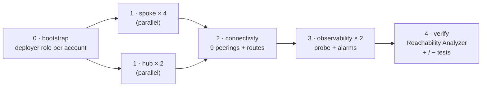

# Module Organization and Deployment

## 1. Layout

```
.
├── modules/                         # reusable, versioned building blocks (no providers configured)
│   ├── network_plan/                # pure data: reads network-plan.yaml, derives subnet CIDRs
│   ├── vpc/                         # tiered 3-AZ VPC, per-tier route tables, NAT, endpoints, data NACL, flow logs
│   ├── vpc_peering/                 # cross-account + cross-region peering, both sides' routes (aws.requester / aws.accepter)
│   ├── security_groups/
│   │   ├── central_api/             # hub: default-deny egress, 443 to regional gateways only
│   │   └── regional_gateway/        # spoke: 443 from hub app CIDRs only
│   ├── connectivity_probe/          # Lambda probe matrix (DNS/TCP/TLS/TTFB), dual-region metrics
│   ├── connectivity_alerting/       # pair alarms + composite correlation alarms
│   ├── network_guardrails/          # out-of-band change detection + Config rules
│   ├── alert_topic/                 # KMS-encrypted SNS for pages/tickets
│   └── iam_network_deployer/        # CI deployer role with data-plane-denying boundary
├── live/
│   ├── bootstrap/deployer-role/     # once per account, break-glass creds
│   └── prod/
│       ├── network-plan.yaml        # single source of truth (CIDRs, accounts, regions, layouts)
│       ├── spoke/                   # one root, 4 instances: -var spoke=us|eu|ca|apac
│       ├── hub/                     # one root, 2 instances: -var hub=use1|euw1
│       ├── connectivity/            # all 9 peerings, one provider alias per account/region
│       └── observability/           # per hub region: probe (hub account) + full alarm matrix (observability account)
├── policies/scp/                    # SCPs this design relies on (attached by the org pipeline)
└── docs/
```

### Why this shape

- **Modules don't configure providers.** `vpc_peering` declares `configuration_aliases = [aws.requester, aws.accepter]`, and the caller decides which account and region each side is. The same module serves hub↔spoke and hub↔hub, intra- or inter-region.
- **One root per *kind* of stack, many instances.** `spoke/` is applied four times with different `-var spoke=…` and backend keys. The four regions can't drift apart in shape, and adding a region adds no code to `spoke/`.
- **Stacks split by blast radius and ownership:**
  - `spoke` runs in a regional account only. It can't touch another jurisdiction (provider `allowed_account_ids` + region-lock SCP).
  - `hub` runs in one hub account only. Each hub has its own account.
  - `connectivity` spans every hub and regional account. That is intentional: both sides of a peering, and their routes, are reviewed as one diff and applied as one unit.
  - `observability` spans two accounts: the probe runs in the hub account (inside the hub VPC, so it tests the real path), and the alarm matrix lives in the observability account. It's a separate stack so alarm tuning never risks a network change.
- **State per instance** (`network/spoke/eu.tfstate`, …) keeps lock contention and blast radius small. State holds no event data. A residency-strict auditor could place each spoke's state in an in-jurisdiction bucket by changing its backend file only.
- **Environments (not included in this repo):** a `live/nonprod/` tree would mirror `live/prod/` with its own `network-plan.yaml` (a different 10.x block, single NAT, one hub). Modules are promoted by git tag: `source = "git::…//modules/vpc?ref=v1.4.0"` once modules move to their own repo.

## 2. Deployment order



```bash
# 0. once per account (admin credentials)
cd live/bootstrap/deployer-role && terraform init -backend-config=... && terraform apply -var account=eu

# 1. VPCs (each in its own account; spokes and hubs in parallel)
cd live/prod/spoke && terraform init -reconfigure -backend-config=backends/eu.hcl && terraform apply -var spoke=eu
cd live/prod/hub   && terraform init -reconfigure -backend-config=backends/use1.hcl && terraform apply -var hub=use1

# 2. peering mesh (reads VPC/route-table IDs from step-1 state)
cd live/prod/connectivity && terraform init -backend-config=backends/prod.hcl && terraform apply

# 3. monitoring (both hub regions)
cd live/prod/observability && terraform init -reconfigure -backend-config=backends/use1.hcl && terraform apply -var hub=use1
```

A `Makefile` wraps these (`make plan STACK=spoke INSTANCE=eu`).

## 3. CI/CD (`.github/workflows/terraform.yml`)

1. **On pull request:** `terraform fmt -check`, `validate`, `tflint` and `terraform test`, then `plan` for every affected stack instance. Plans are posted to the PR and stored as artifacts (audit evidence).
2. **Auth:** GitHub OIDC → `github-actions-network-pipeline` in the tooling account → `terraform-network-deployer` in each target account. No static keys.
3. **On merge to main:** apply in dependency order. Each production stack uses a GitHub Environment with required reviewers.
4. **Progressive rollout:** non-prod first, then prod **one hub at a time and one spoke at a time**. `connectivity` applies only after both sides exist.
5. **Post-apply verification (designed, not yet in the pipeline):** Reachability Analyzer positive and negative path checks. Once the services exist, the pipeline should fail if a hub can reach any spoke data subnet.
6. **Nightly drift detection:** `plan -detailed-exitcode` on every instance. Exit code 2 opens a ticket.

## 4. Common changes

**Add a jurisdiction (e.g. UK):**
1. Add `spokes.uk` to `network-plan.yaml` (next free /16, `allowed_regions`, gateway FQDN). Create `backends/uk.hcl`.
2. Bootstrap the deployer role in the new account and attach the region-lock SCP.
3. `apply` `spoke` with `-var spoke=uk`.
4. Add `provider "aws" { alias = "spoke_uk" }` and a `peering-uk.tf` (two module blocks, copy of any other spoke file) in `connectivity`.
5. Re-apply both `hub` instances (SGs pick up the new spoke from the plan automatically) and both `observability` instances (the probe target list and alarm matrix extend automatically).

**Pin a jurisdiction to its own hub** (if Legal requires in-jurisdiction processing): remove that spoke's peering module for the out-of-jurisdiction hub, and filter that hub out of `hub_source_cidrs` in `spoke/main.tf`. One reviewed PR.

**Swap a spoke to PrivateLink** (overlapping CIDR): replace that spoke's two `vpc_peering` blocks with a PrivateLink consumer module that targets the gateway's NLB. The gateway, SGs, probe and alarms are unchanged because the interconnect tier is the contract.

## 5. Rollback

- Network resources are declarative: revert the PR and apply. Peering routes are additive, and removing a route only affects the path it names.
- Destroying a peering connection is guarded by SCP (pipeline-only) and by the alarm matrix. Because each spoke has two paths, removing and recreating one connection is a SEV3 event, not an outage.
