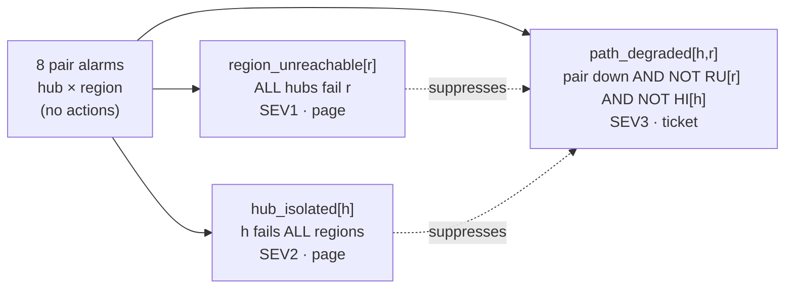

# Monitoring and Alerting for Cross-Region Connectivity

This goes with the [design doc](architecture.md). The code for it is in `modules/connectivity_probe`, `modules/connectivity_alerting`, `modules/network_guardrails` and the flow-log parts of `modules/vpc`.

## 1. Goals

1. **Detect** a broken hub → region path within about 30 seconds, before reviewers notice.
2. **Localize** the failure domain automatically: one path, one hub, or one region. Each has a different owner and urgency.
3. **Page only on impact.** A single path failure that the redundant hub absorbs is a ticket, not a 3 a.m. page.
4. **Keep alerting alive through a region loss.** The monitoring must be more available than the thing it monitors.
5. **Treat unexpected network changes as a signal too**, not just whether traffic gets through.

## 2. The core problem: VPC peering has no metrics

VPC peering connections publish **no CloudWatch metrics**: no bytes, no drops, no state metric. (Transit Gateway does, which is one of its real advantages; see ADR-0001.) So I measure the path **from where the traffic originates**, using five signal sources that complement each other:

| # | Signal | Source | Answers |
|---|---|---|---|
| 1 | **Synthetic probes** (active) | Lambda in each hub's app subnets with the central API's SG, probing each regional gateway every 10 s | "Can hub X reach region Y *right now*, and how fast?" Works with zero user traffic. |
| 2 | **Real-traffic RED metrics** | Central API: rate, errors, duration per target region, plus circuit-breaker state and cross-hub fallbacks | "Are users actually affected?" Catches what probes miss (e.g. only large responses failing). |
| 3 | **Endpoint health** | Regional gateway ALB, hub ALB, NAT gateway, Global Accelerator | "Is the far end healthy, or is it the network in between?" |
| 4 | **VPC Flow Logs** | Every VPC (v5 fields incl. `traffic-path`, `flow-direction`) | "Is traffic being rejected, and where?" Also capacity trends per path. |
| 5 | **Change and configuration** | CloudTrail via EventBridge, AWS Config, Terraform drift, Reachability Analyzer | "Did someone or something change the path?" Prevention and forensics. |

## 3. Metrics that matter

### 3.1 Path health (probe, namespace `Network/CrossRegion`, dimensions `SourceHub`, `TargetRegion`)

> **Deployment prerequisite:** the regional gateways require mutual TLS, so the probe needs its client certificate (`mtls_secret_arn`, issued by the hub's Private CA) before it is switched on. Without it every probe fails the TLS handshake and the whole alarm matrix fires. That is correct behavior, because the probe can't complete the real path, but it is noise during rollout.

The probe measures each phase separately because each phase points to a different cause:

| Metric | Healthy | Why it matters |
|---|---|---|
| `ProbeSuccess` | 1 | Primary availability signal for the path. 0 or missing counts as failure. |
| `DnsMs` | low single-digit ms | Spikes or failures point to Route 53 Resolver / private hosted zone association problems, not the network |
| `TcpConnectMs` | ≈ 1 RTT for the region pair (baseline) | **Pure network latency** across peering. Timeouts mean route/SG/NACL/peering failure. Gradual rise means backbone congestion or rerouting. |
| `TlsHandshakeMs` | ≈ 2 RTT | Failures with a good TCP connect point to **certificates** (expired client cert, trust-store change), not the network |
| `TimeToFirstByteMs` | baseline + gateway processing | Rising TTFB with flat TCP connect means the **regional gateway** is slow, not the network |

This decomposition is the main debugging aid: an on-call engineer can tell within one glance at the dashboard whether to call the network, PKI, or the regional service owner.

### 3.2 Real traffic (central API, per target region)

- Request rate, error rate (5xx and timeouts), latency p50/p95/p99 per region
- **Circuit-breaker state** per region (open = we stopped calling it)
- **Cross-hub fallback count**: calls hub A forwarded to hub B. Non-zero means a path is down and redundancy is in use.
- Client-side retries absorbed (from the SDK). This shows the retries doing their job: failures happened, but users didn't see them.

### 3.3 Endpoint health

| Component | Metrics |
|---|---|
| Regional gateway ALB | `HealthyHostCount`, `UnHealthyHostCount`, `TargetResponseTime`, `HTTPCode_ELB_5XX_Count`, `RejectedConnectionCount`, `ClientTLSNegotiationErrorCount` (mTLS failures) |
| NAT gateways | `ErrorPortAllocation`, `PacketsDropCount`, `ConnectionAttemptCount` vs `ConnectionEstablishedCount` |
| Global Accelerator | endpoint health state, `NewFlowCount`, `ProcessedBytesIn/Out` per endpoint group |
| Probe Lambda | `Errors`, `Duration`, `Invocations`, so a broken probe isn't mistaken for a broken network. |

### 3.4 Flow logs

- **`FlowLogRejects`** per VPC (metric filter in `modules/vpc`). On a spoke, rejects *from hub CIDRs to anything except the gateway port* are a security signal: someone is probing beyond the allowed path.
- **Bytes per peering path** (Logs Insights / Athena on `dstaddr` within peer CIDRs): capacity planning and cost attribution.
- `traffic-path` marks egress records that left through peering (inter-region peering has its own value), so cross-region volume can be isolated from everything else. `flow-direction` separates ingress from egress records, so a REJECT can be pinned to the receiving or the sending side of the path.

### 3.5 Configuration and change

- Peering connection status (`active`), checked by the probe's implicit success and by a scheduled `DescribeVpcPeeringConnections` in the drift job
- **Out-of-band network changes**: EventBridge on CloudTrail (`CreateRoute`, `DeleteVpcPeeringConnection`, `AuthorizeSecurityGroupIngress`, …) where the caller is not the pipeline role (`modules/network_guardrails`)
- AWS Config: flow logs enabled, default SG closed, no unauthorized open ports
- Nightly `terraform plan` on every stack. Any diff is drift and opens a ticket.

## 4. Alerting approach

### 4.1 Principles

- **Page on what users feel, not on every raw signal.** The per-path alarms don't notify anyone on their own. Only the correlated alarms built on top of them do.
- **Every page is actionable and links a runbook** (failure domain, likely causes, first three commands).
- **Severity follows user impact, not component importance.** A dead peering connection with the other hub serving is SEV3.
- **Alerting is regionally redundant.** Both hubs' probes write their metrics into the observability account in *both* hub regions, through a write-only role. Each region then evaluates the full matrix. Both notify, and the incident tool de-duplicates on alarm name.

### 4.2 Correlation matrix

Each cell is a pair alarm (`ProbeSuccess` < 1 for 3 consecutive 10-second windows, missing data = breaching):

```
                 us      eu      ca      apac
   hub-use1   [ pair ][ pair ][ pair ][ pair ]   ── all red in a row    → hub_isolated[use1]
   hub-euw1   [ pair ][ pair ][ pair ][ pair ]   ── all red in a row    → hub_isolated[euw1]
                 │
                 └── all red in a column → region_unreachable[us]

   one red cell, row and column otherwise green → path_degraded[hub, region]
```



These are CloudWatch **composite alarms** (`modules/connectivity_alerting`). The `NOT` clauses make one failure produce one alert. If EU is down, on-call gets one SEV1 ("EU unreachable"), not one SEV1 plus two SEV3s.

### 4.3 Severity table

| Alert | Condition | Severity | Route | First action (runbook) |
|---|---|---|---|---|
| `region-<r>-unreachable` | Every hub fails to reach r for 30 s | SEV1 page | Platform on-call + regional owner | Check regional gateway ALB health and AWS Health for the region; check spoke-side change events |
| `hub-<h>-isolated` | Hub h fails every region for 30 s | SEV2 page | Platform on-call | Verify GA drained h and the SLO is intact; check hub NAT/route tables/probe errors |
| `path-<h>-to-<r>-degraded` | One pair down, others fine | SEV3 ticket | Platform team queue | Inspect route tables and peering status; run Reachability Analyzer for the pair |
| `latency-<h>-to-<r>` | p99 TCP connect > baseline × 1.5 for 15 min | SEV3 ticket | Platform team queue | Compare with AWS Health; check for rerouting; check whether other pairs from h are affected |
| Out-of-band network change | Network API call by non-pipeline principal | SEV2 page (prod) | Security + platform on-call | Confirm approved break-glass, else treat as security incident; reconcile with `terraform apply` |
| Flow-log reject spike to spoke from hub CIDRs on non-gateway ports | > baseline | SEV3 ticket → security | Security queue | Identify source ENI; possible misbehaving or compromised hub task |
| Probe Lambda errors | Errors ≥ 1 for 3 min or no invocations | SEV3 ticket | Platform queue | Fix probe; until then, `hub_isolated` may be a false positive |
| mTLS negotiation errors at gateway | `ClientTLSNegotiationErrorCount` > 0 sustained | SEV2 page | Platform on-call | Cert expiry or trust-store drift; check Private CA issuance |

### 4.4 SLO burn-rate alerts (real traffic)

The probe tells us the network is broken. The SLO tells us whether users are hurt. With a 99.9999% target the error budget is about 2.6 seconds per month, so classic multi-window burn-rate alerting reduces to "any sustained error the retries didn't absorb". I therefore use:

- **Platform SLO (6 nines):** page when the post-retry error rate at the edge is non-zero over two consecutive 1-minute windows *and* the 5-minute window. The short window catches fast burns; the longer one confirms.
- **Regional data SLO (99.99%):** standard multi-window burn rates (14.4× over 1 h/5 min → page; 6× over 6 h/30 min → page; 1× over 3 days → ticket), per region.

### 4.5 What fires before users notice, and what doesn't

| Scenario | Users notice? | We know within |
|---|---|---|
| Peering route deleted (one path) | No (fallback hub) | ~30 s (SEV3) + immediate out-of-band-change alert |
| Hub region down | Retried requests only | ~30 s (SEV2) |
| Regional gateway down | Yes, for that region only | ~30 s (SEV1) |
| Gradual cross-region latency regression | Slower pages | 15 min (SEV3) |

## 5. Where monitoring data lives

- **Probe metrics:** written by every hub's probe into the observability account, in both hub regions. Alarms see the whole matrix even though each hub has its own account, and neither detection nor paging depends on a single region.
- **Everything else:** CloudWatch **cross-account observability (OAM)**. Every account links to a sink in the observability account, so metrics, logs and traces from all regions appear in one console and in **Amazon Managed Grafana** without copying raw data around. Per the brief, monitoring data contains no PII. Services log event IDs, never event payloads or video URLs, enforced by a log-scrubbing test in CI.
- **Retention:** 90 days for flow logs in CloudWatch (hot), with long-term copies in the in-region log-archive bucket for audit.

### Dashboards

1. **Connectivity matrix:** hub × region heatmap of `ProbeSuccess` and p99 `TcpConnectMs`. The on-call home page.
2. **Path drill-down:** DNS / TCP / TLS / TTFB stacked per pair, with gateway ALB health on the same time axis.
3. **Edge SLO:** platform success rate after retries, retries absorbed, cross-hub fallbacks.
4. **Change log:** out-of-band network changes and Terraform applies overlaid on the matrix ("what changed right before it broke?").

## 6. Proving it works

- **Negative reachability tests after every apply** (to be added to the pipeline once the services exist): AWS Reachability Analyzer must report hub app ENI → spoke gateway ALB **reachable**, and hub app ENI → spoke Aurora ENI **not reachable**. Isolation is tested, not assumed.
- **Game days with AWS Fault Injection Service:** disrupt cross-region connectivity on one hub's route tables, black-hole one spoke, kill the probe. Each experiment states which alert must fire, within how long, and that the platform SLO must hold.
- **Alert hygiene review** every two weeks: every page from the last period is checked for whether it was actionable. Non-actionable alerts are fixed or deleted.
